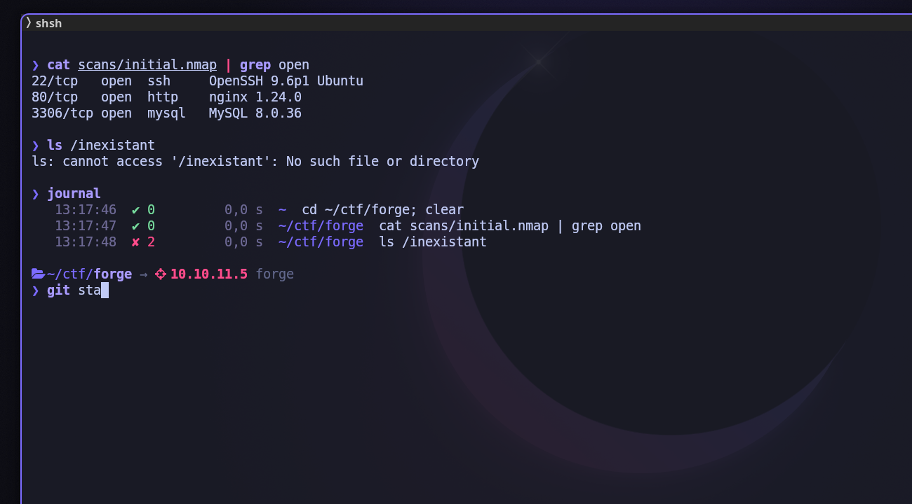

<div align="center">

# shsh — le shadow shell

**Un shell compatible bash, écrit en Rust, pensé en français, qui connaît ton bureau et ta mission.**

[English](README.md) · [Licence : GPL-3.0](LICENSE) · [Shadow OS](https://github.com/jordanwinner/shadow-os)



</div>

Shell interactif écrit en Rust pour [Shadow OS](https://github.com/jordanwinner/shadow-os) : compatible POSIX (et une bonne
partie de bash), messages en français, prompt aux couleurs Éclipse. Il fonctionne
aussi sans Shadow OS : l'intégration au bureau se désactive d'elle-même.

**En bref** — suggestions et coloration en direct · complétions décrites (apt, systemd,
git, docker, cargo, options lues dans les pages de manuel) · code de retour et durée
toujours dans le prompt · `journal` des commandes (dossier, code, durée) · Ctrl+R par
contexte (tout, ce dossier, la mission, les échecs) · `preuve COMMANDE` pour garder la
sortie d'une commande comme preuve · assistant `? question` qui propose une commande sans
l'exécuter · mode vi · 169 extraits comparés à bash, 76 tests interactifs.

**Mesures** (sur la machine de développement) — démarrage de `shsh -c true` : 7,5 ms
(bash 9,5 ms, zsh 9,2 ms) · mémoire : 4 Mo, comme bash · une boucle de 200 000 tours
reste 24 % plus lente que bash.

## Installation

```sh
outils/installer.sh            # compile, installe /usr/local/bin/shsh, l'ajoute à /etc/shells
outils/installer.sh --defaut   # … et en fait le shell de connexion (chsh)
```

Configuration : `~/.shshrc` (syntaxe POSIX). `outils/importer-zshrc.py` reprend
les alias et fonctions d'un `~/.zshrc`.

## Ce qu'il sait faire

**Langage** — pipes, redirections (`2>&1`, `&>`, `<<<`, here-docs), `&&` `||`,
`if/while/until/for/case`, `for ((…))`, fonctions et `local`, `[[ … ]]` avec
`=~` et `BASH_REMATCH`, `(( … ))`, tableaux (`a=(…)`, `${a[@]}`, `${!a[@]}`,
creux), tableaux associatifs (`declare -A`), entiers (`declare -i`), `case`
avec `;&` et `;;&`, `${x@Q}` `${x@U}`, `${!préfixe*}`, `{fd}>fichier`, `$LINENO`, toutes les
expansions `${…}` (défaut, motifs, remplacement, casse, sous-chaînes,
indirection), `$(…)`, `$(< fichier)`, `<(…)`, accolades `{a,b}` `{1..10}`,
globbing avec `**` récursif, `time`, `set -euxo pipefail`, `shopt`
(nullglob, dotglob, nocasematch…), `trap`, `getopts`, `mapfile`.

**Interactif** — coloration syntaxique en direct (commande inconnue en rose,
chemins existants soulignés), suggestions grisées tirées de l'historique,
complétion Tab avec descriptions (fichiers, commandes, variables, sous-commandes
et branches git, hôtes ssh, cibles make, paquets apt, unités systemd, processus
pour `kill`/`pkill`, sous-commandes de docker, cargo, npm, pip, tmux, snap et
flatpak, scripts `npm run`, options `--…` lues dans les pages de manuel), historique en liste filtrée (Ctrl+R ; Ctrl+R à nouveau change de vue : tout → ce dossier → mission → échecs, d'après le journal), abréviations (`abbr gs='git status'`), auto-cd,
« vouliez-vous dire … ? » (ou le paquet apt qui fournit la commande absente), contrôle des tâches complet (Ctrl+Z, `fg`, `bg`,
`jobs`, `kill %n`), saisie multiligne, `!!` / `!$`, Alt+E pour retravailler la ligne dans `$EDITOR`, `set -o vi` pour l'édition façon vi (`❮` en mode normal ; Tab, Ctrl+R et les raccourcis de shsh restent en insertion ; `set -o emacs` pour revenir), Alt+S pour ajouter `sudo`.

**Prompt Éclipse** — dossier (relatif au dépôt git), branche, état et avance/retard sur le distant, environnement Python, tâches
en arrière-plan, code de retour toujours affiché (`✔ 0`, `✘ 137 KILL`), durée des commandes longues, heure ; les
prompts passés se replient en `❯ commande`.

**Shadow OS** — shsh lit directement l'état du bureau, sans rien ajouter à
`~/.shshrc` : la cible de la mission en cours (`shadow cible 10.10.11.5 nom`)
s'affiche dans le prompt et `$CIBLE`, `$TARGET`, `$MISSION` sont posées dans
tous les terminaux ouverts, puis retirées à `shadow cible fin` ; le mode du
bureau (Pentest, Focus, Jeu, Nuit) apparaît à droite. Une `$CIBLE` posée à la
main n'est jamais écrasée. Tab complète `shadow …` avec ses sous-commandes et
les modes installés. `SHSH_SHADOW=0` coupe le tout.

**Journal** — chaque commande tapée est notée avec son heure, son dossier, son
code de retour et sa durée (`~/.local/share/shsh/journal.tsv`). `journal` affiche
les dernières ; `journal ici`, `journal echecs`, `journal lentes`,
`journal cherche MOTIF`, `journal aujourdhui` filtrent. Pendant une mission
Shadow OS, les mêmes lignes vont aussi dans `$MISSION/journal.md`, que
`shadow rapport` transforme en rapport. Les lignes exclues de l'historique
(espace en tête, `SHSH_HISTORY_IGNORE`) ne sont jamais écrites ; `SHSH_JOURNAL=0`
coupe tout.

**Preuves de mission** — `preuve nmap -sV $CIBLE` exécute la commande
normalement (couleurs, interactivité, via `script`) et garde sa sortie nettoyée
dans `$MISSION/preuves/AAAAMMJJ-HHMMSS-nom.txt`, avec date, cible, code de retour
et durée. Pour un tube, la ligne entière entre guillemets :
`preuve 'curl -s http://$CIBLE/ | grep -i version'`. Le journal de mission y
renvoie et `shadow rapport` insère un extrait sous la commande. Seules les
variables exportées passent à la commande.

**Assistant `?`** — `? lister les ports ouverts de la cible` : la commande
proposée arrive dans la ligne de saisie, jamais exécutée d'office (Entrée la
lance, Ctrl+C l'abandonne), avec une phrase d'explication. Les commandes
destructrices (`rm -rf ~/*`, `dd of=/dev/…`, `mkfs`…) sont signalées en rouge.
`? pourquoi ça a planté` joint la dernière commande en échec. Modèle : celui de
jordan-cli (Groq) ou `GROQ_API_KEY` / `SHSH_ASSISTANT_MODELE`. Seuls partent la
question, le dossier relatif à `~`, la cible de la mission Shadow et la dernière
commande ratée ; la clé passe par un fichier d'en-têtes privé, jamais par la
ligne de commande. `SHSH_ASSISTANT_CONTEXTE=0` n'envoie que la question,
`SHSH_ASSISTANT=0` coupe l'assistant.

**Crochets** — `shsh_precmd`, `shsh_preexec "$ligne"`, `chpwd`.
`SHSH_HISTORY_IGNORE` (regex) exclut les lignes sensibles de l'historique.

## Tests

```sh
tests/compat.sh          # compare la sortie de shsh à celle de bash sur ~160 extraits
python3 tests/pty_test.py  # pilote un shsh interactif dans un pseudo-terminal
```

## Licence

shsh est un logiciel libre, publié sous la [licence publique générale GNU v3.0](LICENSE).
