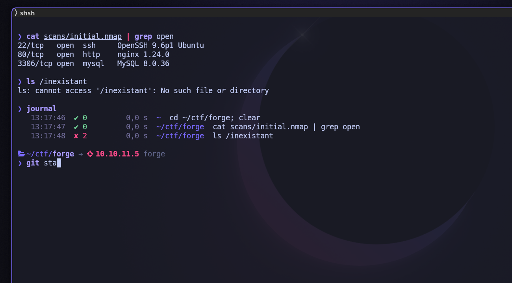

<div align="center">

# shsh — the shadow shell

**A bash-compatible shell written in Rust, designed in French, that knows your desktop and your mission.**

[Français](README.fr.md) · [License: GPL-3.0](LICENSE) · [Shadow OS](https://github.com/jordanwinner/shadow-os)



</div>

shsh is the interactive shell of [Shadow OS](https://github.com/jordanwinner/shadow-os). It runs POSIX scripts and a large part of bash, speaks French (messages, help, « did you mean… ? »), and draws an Éclipse-coloured prompt. It also works without Shadow OS: the desktop integration simply switches itself off.

**At a glance**: live suggestions and syntax highlighting · described completions (apt, systemd, git, docker, cargo, options read from man pages) · exit code and duration always in the prompt · a command `journal` (folder, exit code, duration) · context-aware Ctrl+R (everything, this folder, the mission, failures) · `preuve COMMAND` keeps a command's output as evidence · `? question` assistant that suggests a command without running it · vi mode · 169 snippets compared against bash, 76 interactive tests.

**Measured** (on the development machine): `shsh -c true` starts in 7.5 ms (bash 9.5 ms, zsh 9.2 ms) · 4 MB of memory, like bash · a 200,000-iteration loop is still 24% slower than bash.

## Installation

```sh
outils/installer.sh            # build, install /usr/local/bin/shsh, add it to /etc/shells
outils/installer.sh --defaut   # … and make it the login shell (chsh)
```

Configuration lives in `~/.shshrc` (POSIX syntax). `outils/importer-zshrc.py` imports aliases and functions from a `~/.zshrc`.

## What it does

**Language**: pipes, redirections (`2>&1`, `&>`, `<<<`, here-docs), `&&` `||`, `if/while/until/for/case`, `for ((…))`, functions and `local`, `[[ … ]]` with `=~` and `BASH_REMATCH`, `(( … ))`, indexed and associative arrays (`declare -A`), `declare -i`, `case` with `;&` and `;;&`, `${x@Q}` `${x@U}`, `${!prefix*}`, `{fd}>file`, `$LINENO`, every `${…}` expansion, `$(…)`, `$(< file)`, `<(…)`, braces `{a,b}` `{1..10}`, recursive `**` globbing, `time`, `set -euxo pipefail`, `shopt` (nullglob, dotglob, nocasematch…), `trap`, `getopts`, `mapfile`.

**Interactive**: live highlighting (unknown commands in pink, existing paths underlined), history-based suggestions, Tab completion with descriptions, history list with context views (Ctrl+R, then Ctrl+R again: everything → this folder → mission → failures), abbreviations (`abbr gs='git status'`), auto-cd, « did you mean… ? » (or the apt package that provides a missing command), full job control (Ctrl+Z, `fg`, `bg`, `jobs`, `kill %n`), multi-line input, `!!` / `!$`, Alt+E to edit the line in `$EDITOR`, Alt+S to prepend `sudo`, `set -o vi` for vi editing (`❮` in normal mode).

**Éclipse prompt**: folder (relative to the git repository), branch, status and ahead/behind, Python environment, background jobs, exit code always shown (`✔ 0`, `✘ 137 KILL`), duration of long commands, clock; past prompts collapse to `❯ command`.

**Shadow OS integration**: shsh reads the desktop state directly, with nothing to add to `~/.shshrc`: the current mission target appears in the prompt and `$CIBLE`, `$TARGET`, `$MISSION` are set in every open terminal; the desktop mode (Pentest, Focus, Game, Night) appears on the right; stealth mode shows `tor`, or `tor arrêté : en clair` in red if Tor stopped. `SHSH_SHADOW=0` turns it all off.

**Journal**: every command you type is recorded with its time, folder, exit code and duration (`~/.local/share/shsh/journal.tsv`). `journal` shows the latest ones; `journal ici`, `journal echecs`, `journal lentes`, `journal cherche PATTERN` filter them. During a Shadow mission the same lines also go to `$MISSION/journal.md`, which `shadow rapport` turns into a report. Lines excluded from history (leading space, `SHSH_HISTORY_IGNORE`) are never written; `SHSH_JOURNAL=0` disables it.

**Mission evidence**: `preuve nmap -sV $CIBLE` runs the command normally (colours, interactivity, through `script`) and keeps its cleaned output in `$MISSION/preuves/`, with date, target, exit code and duration. The mission journal links to it and `shadow rapport` inserts an excerpt under the command.

**`?` assistant**: `? list the open ports of the target` puts a suggested command on the input line, never runs it (Enter runs it, Ctrl+C drops it), with a one-line explanation. Destructive commands (`rm -rf ~/*`, `dd of=/dev/…`, `mkfs`…) are flagged in red, and answers containing control characters are refused. What leaves the machine is redacted: the home directory becomes `~` and the user name becomes « utilisateur ». Uses a Groq API key (`GROQ_API_KEY`); `SHSH_ASSISTANT=0` disables it.

**Hooks**: `shsh_precmd`, `shsh_preexec "$line"`, `chpwd`. `SHSH_HISTORY_IGNORE` (regex) keeps sensitive lines out of history.

## Tests

```sh
tests/compat.sh            # compares shsh output with bash on 169 snippets
python3 tests/pty_test.py  # drives an interactive shsh in a pseudo-terminal (76 checks)
cargo test                 # unit tests
```

## License

shsh is free software, released under the [GNU General Public License v3.0](LICENSE).
